# ERD cơ sở dữ liệu Nông Sản Sạch

Schema được thiết kế cho MySQL 5.7+/MariaDB 10.x, dùng InnoDB, `utf8mb4_unicode_ci`, khóa ngoại và index cho các truy vấn quan hệ phổ biến. Bảng vùng dùng `parent_id` và `level` để biểu diễn cây đúng hai cấp: miền → tỉnh/vùng. Các cột snapshot trong đơn hàng/lịch sử giữ lại thông tin tại thời điểm phát sinh.

## Sơ đồ quan hệ

```mermaid
erDiagram
    banners {
        bigint id PK
        varchar title
        varchar image_url
        enum status
    }
    pages {
        bigint id PK
        varchar slug UK
        longtext content
        enum status
    }
    contacts {
        bigint id PK
        varchar email
        text message
        enum status
    }
    settings {
        varchar setting_key PK
        text setting_value
    }
    login_attempts {
        bigint id PK
        char email_hash
        char ip_hash
        tinyint failed_attempts
        datetime locked_until
    }
    regions {
        bigint id PK
        bigint parent_id FK
        varchar name
        tinyint level
        varchar slug UK
        text description
        tinyint is_active
    }
    categories {
        bigint id PK
        bigint parent_id FK
        varchar name
        varchar slug UK
        int sort_order
        tinyint is_active
    }
    products {
        bigint id PK
        bigint category_id FK
        bigint region_id FK
        bigint farm_id FK
        varchar slug UK
        varchar sku UK
        decimal price
        decimal sale_price
        varchar short_description
        enum status
        tinyint is_featured
        int total_stock
        int min_stock
        datetime deleted_at
    }
    farms {
        bigint id PK
        bigint region_id FK
        varchar name
        varchar address
        text certifications
        varchar certification_number
        date certification_expires_at
        varchar certificate_image_url
        decimal latitude
        decimal longitude
        enum status
    }
    product_batches {
        bigint id PK
        bigint product_id FK
        bigint farm_id FK
        varchar batch_code UK
        char qr_token UK
        date harvested_at
        date packed_at
        date expires_at
        int quantity_received
        int quantity_remaining
        decimal average_unit_cost
        enum inspection_result
        enum status
        text recall_reason
    }
    trace_events {
        bigint id PK
        bigint batch_id FK
        enum event_type
        datetime event_at
        varchar image_url
        int sort_order
    }
    trace_scans {
        bigint id PK
        bigint batch_id FK
        datetime scanned_at
        char ip_hash
        varchar user_agent
    }
    warehouse_receipts {
        bigint id PK
        varchar receipt_no UK
        bigint supplier_farm_id FK
        enum status
        datetime confirmed_at
    }
    warehouse_receipt_items {
        bigint id PK
        bigint receipt_id FK
        bigint batch_id FK
        int quantity
        decimal unit_cost
    }
    inventory_movements {
        bigint id PK
        bigint product_id FK
        bigint batch_id FK
        enum movement_type
        int quantity
        decimal unit_cost
        int balance_after
        varchar reference_type
        bigint reference_id
    }
    stock_reservations {
        bigint id PK
        bigint order_id FK
        bigint batch_id FK
        int quantity
        datetime expires_at
        enum status
    }
    stocktakes {
        bigint id PK
        varchar stocktake_no UK
        enum status
    }
    stocktake_items {
        bigint id PK
        bigint stocktake_id FK
        bigint batch_id FK
        int system_quantity
        int counted_quantity
    }
    document_sequences {
        varchar sequence_key PK
        int next_value
    }

    users ||--o{ addresses : has
    users ||--o{ password_resets : requests
    users ||--o{ email_verifications : verifies
    users ||--o{ carts : owns
    users ||--o{ orders : places
    users ||--o{ reviews : writes
    users ||--o{ wishlists : saves
    users ||--o{ notifications : receives
    users ||--o{ audit_logs : performs
    users ||--o{ warehouse_receipts : receives

    regions o|--o{ regions : contains
    regions ||--o{ farms : located_in
    regions ||--o{ products : sourced_from
    regions ||--o{ addresses : destination
    regions ||--o{ shipping_fees : priced_by
    categories o|--o{ categories : contains
    categories ||--o{ products : classifies
    farms ||--o{ products : supplies
    farms ||--o{ product_batches : harvested_at

    products ||--o{ product_images : displays
    products ||--o{ product_batches : tracked_as
    products ||--o{ inventory_movements : changes
    products ||--o{ cart_items : added_to
    products o|--o{ order_items : snapshot_of
    products ||--o{ reviews : reviewed
    products ||--o{ wishlists : saved_in
    products ||--o{ flash_sale_items : discounted

    product_batches ||--o{ trace_events : traced_by
    product_batches ||--o{ trace_scans : scanned
    product_batches ||--o{ warehouse_receipt_items : received
    product_batches o|--o{ inventory_movements : moved
    product_batches o|--o{ order_items : allocated

    warehouse_receipts ||--|{ warehouse_receipt_items : contains
    farms o|--o{ warehouse_receipts : supplies
    orders ||--o{ stock_reservations : reserves
    product_batches ||--o{ stock_reservations : held_from
    stocktakes ||--|{ stocktake_items : counts
    carts ||--|{ cart_items : contains
    orders ||--|{ order_items : contains
    orders ||--o{ order_status_history : changes
    orders ||--o{ payments : paid_by
    orders ||--o{ voucher_usages : applies
    orders o|--o{ flash_sale_purchases : fulfills

    vouchers ||--o{ voucher_usages : redeemed
    flash_sales ||--|{ flash_sale_items : offers
    flash_sale_items ||--o{ flash_sale_purchases : purchased
    users ||--o{ flash_sale_purchases : buys
    orders o|--o{ reviews : verified_by
```

## Mô tả bảng

### Người dùng và địa lý

- `users`: tài khoản, email duy nhất, mật khẩu bcrypt, vai trò `customer/admin/staff_sales/staff_warehouse` và trạng thái.
- `addresses`: địa chỉ nhận hàng gắn với người dùng; giữ tỉnh/vùng tham chiếu để chọn phí vận chuyển.
- `password_resets`: token băm, hạn sử dụng và trạng thái dùng lại của yêu cầu đặt lại mật khẩu.
- `email_verifications`: token xác minh email có thời hạn, lưu dạng băm.
- `login_attempts`: số lần đăng nhập sai và thời gian khóa theo cặp SHA-256 email/IP; không có khóa ngoại để giữ bộ đếm độc lập với việc tài khoản có tồn tại hay không.
- `regions`: cây địa lý hai cấp; `parent_id` trỏ tới miền cha và `level` xác định miền hay tỉnh/vùng; có mô tả và trạng thái hiển thị.
- `categories`: danh mục nhiều cấp qua `parent_id`.
- `farms`: nông trại/nhà cung cấp, vùng, địa chỉ, tọa độ, ảnh hồ sơ và giấy chứng nhận, số/ngày hết hạn chứng nhận, trạng thái.

### Sản phẩm và truy xuất

- `products`: danh mục, nguồn vùng/nông trại, slug/SKU, đơn vị, giá gốc/khuyến mãi, mô tả, hướng dẫn bảo quản, chứng nhận, cờ nổi bật, tồn kho tổng và ngưỡng cảnh báo `min_stock`; `deleted_at` dùng cho xóa mềm. Các index hỗ trợ lọc theo trạng thái, danh mục, vùng, giá và sản phẩm mới/nổi bật.
- `product_images`: nhiều ảnh cho một sản phẩm, có thứ tự và cờ ảnh chính.
- `product_batches`: mã lô bất biến và QR token duy nhất; liên kết sản phẩm/nông trại, ngày thu hoạch/đóng gói/hết hạn, số lượng nhập/còn, giá nhập bình quân, kiểm định, trạng thái và lý do thu hồi.
- `trace_events`: nhật ký theo thứ tự của từng lô: gieo trồng, chăm sóc, thu hoạch, sơ chế, đóng gói và vận chuyển; có mô tả, ngày, địa điểm và ảnh tùy chọn.
- `trace_scans`: lượt xem trang truy xuất, ghi thời điểm, hash SHA-256 của IP và user-agent tối đa 200 ký tự; ứng dụng loại lượt trùng cùng IP/lô trong cửa sổ 10 phút.

### Kho

- `warehouse_receipts`: phiếu nhập kho nháp/đã xác nhận/đã hủy, nông trại cung cấp, người nhận, thời điểm và thông tin hủy; xác nhận cộng tồn qua `InventoryService`, hủy tạo movement điều chỉnh đảo chứ không sửa lịch sử.
- `warehouse_receipt_items`: các lô/số lượng trong một phiếu nhập; mỗi lô chỉ xuất hiện một lần trong cùng phiếu.
- `inventory_movements`: sổ cái nhập, xuất, điều chỉnh và hoàn theo sản phẩm/lô; số lượng signed, kèm giá nhập và số dư sau movement, người thao tác, lý do và tham chiếu. Ứng dụng chỉ INSERT qua `InventoryService`; không cung cấp thao tác sửa/xóa movement.
- `stock_reservations`: lượng giữ chỗ theo đơn/lô và thời hạn. Không dùng cron/Redis; mọi lần đọc tồn khả dụng đánh dấu giữ chỗ hết hạn thành `expired` một cách lazy và khả dụng được tính bằng tồn vật lý trừ giữ chỗ còn hạn.
- `stocktakes` và `stocktake_items`: đợt kiểm kê cùng tồn hệ thống lúc tạo và số đếm; khi xác nhận, `InventoryService` ghi movement cho từng chênh lệch.
- `document_sequences`: bộ đếm khóa dòng trong InnoDB để cấp mã phiếu nhập, kiểm kê và lô duy nhất an toàn khi có yêu cầu đồng thời.

### Giỏ hàng và đơn hàng

- `carts`: giỏ theo tài khoản hoặc session khách; `cart_items` lưu sản phẩm và số lượng duy nhất trong mỗi giỏ.
- `orders`: đơn hàng thuộc người dùng, trạng thái thanh toán/đơn, snapshot người nhận/địa chỉ và tổng tiền tại thời điểm đặt.
- `order_items`: snapshot tên, SKU, đơn vị, đơn giá và thành tiền; có thể gắn lô được phân bổ.
- `order_status_history`: lịch sử trạng thái đơn cùng người thay đổi và ghi chú.
- `payments`: phương thức, số tiền, trạng thái và mã giao dịch của thanh toán.
- `shipping_fees`: phí và ngưỡng miễn phí theo tỉnh/vùng.
- `vouchers`: mã giảm giá cố định hoặc phần trăm, điều kiện tối thiểu, hạn mức và thời gian hiệu lực.
- `voucher_usages`: liên kết voucher, người dùng và đơn đã sử dụng; có index duy nhất chống ghi trùng một lượt dùng trên cùng đơn.

### Flash Sale, nội dung và vận hành

- `flash_sales`: chiến dịch cùng thời gian và trạng thái; trạng thái đang diễn ra cần đồng thời thỏa khoảng thời gian.
- `flash_sale_items`: sản phẩm, giá sale, hạn mức và số đã bán; có `CHECK (sold_quantity <= quota)` (MySQL 5.7 chấp nhận nhưng không thực thi CHECK; MariaDB hỗ trợ kiểm tra).
- `flash_sale_purchases`: ghi nhận lượng mua theo người dùng và mục sale; UNIQUE `(user_id, flash_sale_item_id)` giới hạn một bản ghi/người/mục.
- `reviews`: đánh giá 1–5 sao gắn người dùng/sản phẩm và tùy chọn đơn hàng.
- `wishlists`: sản phẩm yêu thích, khóa chính ghép người dùng/sản phẩm.
- `banners`: banner và liên kết hiển thị có thứ tự.
- `pages`: nội dung trang tĩnh theo slug, trạng thái và thời điểm xuất bản.
- `contacts`: tin nhắn liên hệ và trạng thái xử lý.
- `notifications`: thông báo theo người dùng, liên kết và thời điểm đọc.
- `audit_logs`: nhật ký hành động, đối tượng, người thao tác và IP.
- `settings`: cặp khóa/giá trị cấu hình cửa hàng.

## Ghi chú triển khai

- Index tập trung vào khóa ngoại, trạng thái/thời gian, slug/SKU/mã đơn và mã lô để hỗ trợ tra cứu thường dùng.
- Tồn kho chỉ được cập nhật theo lô qua `InventoryService` trong giao dịch InnoDB có khóa dòng; service đồng bộ `products.total_stock` với tổng `product_batches.quantity_remaining`. Tổng signed movement của mỗi lô phải bằng `quantity_remaining`; migration kho chỉ thêm movement cân bằng, không sửa/xóa movement cũ.
- Khả dụng bán hàng chỉ tính lô `selling`, chưa hết hạn, không lỗi kiểm định; lượng giữ chỗ còn hạn được trừ khỏi số lượng. Sự kiện hết hạn được dọn lazy khi có truy cập, phù hợp shared hosting không có cron.
- Trên MySQL 5.7, các ràng buộc `CHECK` cho số lượng lô, hạn mức Flash Sale và điểm đánh giá có thể không được thực thi. Tầng ứng dụng phải kiểm tra các điều kiện này trước khi ghi.
- Dữ liệu SQL mẫu có thông tin chứng nhận minh họa, không thay thế giấy tờ kiểm định thực tế.
