# ERD cơ sở dữ liệu Nông Sản Sạch

Schema được thiết kế cho MySQL 5.7+/MariaDB 10.x, dùng InnoDB, `utf8mb4_unicode_ci`, khóa ngoại và index cho các truy vấn quan hệ phổ biến. Bảng vùng dùng `parent_id` và `level` để biểu diễn cây đúng hai cấp: miền → tỉnh/vùng. Các cột snapshot trong đơn hàng/lịch sử giữ lại thông tin tại thời điểm phát sinh.

## Sơ đồ quan hệ

```mermaid
erDiagram
    banners {
        bigint id PK
        varchar title
        varchar image_url
        enum status
    }
    pages {
        bigint id PK
        varchar slug UK
        longtext content
        enum status
    }
    contacts {
        bigint id PK
        varchar email
        text message
        enum status
    }
    settings {
        varchar setting_key PK
        text setting_value
    }
    login_attempts {
        bigint id PK
        char email_hash
        char ip_hash
        tinyint failed_attempts
        datetime locked_until
    }

    users ||--o{ addresses : has
    users ||--o{ password_resets : requests
    users ||--o{ email_verifications : verifies
    users ||--o{ carts : owns
    users ||--o{ orders : places
    users ||--o{ reviews : writes
    users ||--o{ wishlists : saves
    users ||--o{ notifications : receives
    users ||--o{ audit_logs : performs
    users ||--o{ warehouse_receipts : receives

    regions o|--o{ regions : contains
    regions ||--o{ farms : located_in
    regions ||--o{ products : sourced_from
    regions ||--o{ addresses : destination
    regions ||--o{ shipping_fees : priced_by
    categories o|--o{ categories : contains
    categories ||--o{ products : classifies
    farms ||--o{ products : supplies

    products ||--o{ product_images : displays
    products ||--o{ product_batches : tracked_as
    products ||--o{ inventory_movements : changes
    products ||--o{ cart_items : added_to
    products o|--o{ order_items : snapshot_of
    products ||--o{ reviews : reviewed
    products ||--o{ wishlists : saved_in
    products ||--o{ flash_sale_items : discounted

    product_batches ||--o{ trace_events : traced_by
    product_batches ||--o{ warehouse_receipt_items : received
    product_batches o|--o{ inventory_movements : moved
    product_batches o|--o{ order_items : allocated

    warehouse_receipts ||--|{ warehouse_receipt_items : contains
    carts ||--|{ cart_items : contains
    orders ||--|{ order_items : contains
    orders ||--o{ order_status_history : changes
    orders ||--o{ payments : paid_by
    orders ||--o{ voucher_usages : applies
    orders o|--o{ flash_sale_purchases : fulfills

    vouchers ||--o{ voucher_usages : redeemed
    flash_sales ||--|{ flash_sale_items : offers
    flash_sale_items ||--o{ flash_sale_purchases : purchased
    users ||--o{ flash_sale_purchases : buys
    orders o|--o{ reviews : verified_by
```

## Mô tả bảng

### Người dùng và địa lý

- `users`: tài khoản, email duy nhất, mật khẩu bcrypt, vai trò `customer/admin/staff_sales/staff_warehouse` và trạng thái.
- `addresses`: địa chỉ nhận hàng gắn với người dùng; giữ tỉnh/vùng tham chiếu để chọn phí vận chuyển.
- `password_resets`: token băm, hạn sử dụng và trạng thái dùng lại của yêu cầu đặt lại mật khẩu.
- `email_verifications`: token xác minh email có thời hạn, lưu dạng băm.
- `login_attempts`: số lần đăng nhập sai và thời gian khóa theo cặp SHA-256 email/IP; không có khóa ngoại để giữ bộ đếm độc lập với việc tài khoản có tồn tại hay không.
- `regions`: cây địa lý hai cấp; `parent_id` trỏ tới miền cha và `level` xác định miền hay tỉnh/vùng.
- `categories`: danh mục nhiều cấp qua `parent_id`.
- `farms`: nông trại/nhà cung cấp, địa chỉ, vùng và thông tin chứng nhận dạng văn bản.

### Sản phẩm và truy xuất

- `products`: danh mục, nguồn vùng/nông trại, slug/SKU, đơn vị, giá, hướng dẫn bảo quản, chứng nhận và tồn kho tổng.
- `product_images`: nhiều ảnh cho một sản phẩm, có thứ tự và cờ ảnh chính.
- `product_batches`: mã lô và QR token duy nhất; lưu ngày thu hoạch/đóng gói/hết hạn, số lượng nhập/còn và kiểm định.
- `trace_events`: nhật ký theo thời gian của từng lô: gieo trồng, chăm sóc, thu hoạch, sơ chế, đóng gói và vận chuyển.

### Kho

- `warehouse_receipts`: phiếu nhập kho, người nhận, thời điểm và trạng thái.
- `warehouse_receipt_items`: các lô/số lượng trong một phiếu nhập; mỗi lô chỉ xuất hiện một lần trong cùng phiếu.
- `inventory_movements`: sổ nhập, xuất, điều chỉnh và hoàn theo sản phẩm/lô; lưu người thao tác và tham chiếu chứng từ/đơn.

### Giỏ hàng và đơn hàng

- `carts`: giỏ theo tài khoản hoặc session khách; `cart_items` lưu sản phẩm và số lượng duy nhất trong mỗi giỏ.
- `orders`: đơn hàng thuộc người dùng, trạng thái thanh toán/đơn, snapshot người nhận/địa chỉ và tổng tiền tại thời điểm đặt.
- `order_items`: snapshot tên, SKU, đơn vị, đơn giá và thành tiền; có thể gắn lô được phân bổ.
- `order_status_history`: lịch sử trạng thái đơn cùng người thay đổi và ghi chú.
- `payments`: phương thức, số tiền, trạng thái và mã giao dịch của thanh toán.
- `shipping_fees`: phí và ngưỡng miễn phí theo tỉnh/vùng.
- `vouchers`: mã giảm giá cố định hoặc phần trăm, điều kiện tối thiểu, hạn mức và thời gian hiệu lực.
- `voucher_usages`: liên kết voucher, người dùng và đơn đã sử dụng; có index duy nhất chống ghi trùng một lượt dùng trên cùng đơn.

### Flash Sale, nội dung và vận hành

- `flash_sales`: chiến dịch cùng thời gian và trạng thái; trạng thái đang diễn ra cần đồng thời thỏa khoảng thời gian.
- `flash_sale_items`: sản phẩm, giá sale, hạn mức và số đã bán; có `CHECK (sold_quantity <= quota)` (MySQL 5.7 chấp nhận nhưng không thực thi CHECK; MariaDB hỗ trợ kiểm tra).
- `flash_sale_purchases`: ghi nhận lượng mua theo người dùng và mục sale; UNIQUE `(user_id, flash_sale_item_id)` giới hạn một bản ghi/người/mục.
- `reviews`: đánh giá 1–5 sao gắn người dùng/sản phẩm và tùy chọn đơn hàng.
- `wishlists`: sản phẩm yêu thích, khóa chính ghép người dùng/sản phẩm.
- `banners`: banner và liên kết hiển thị có thứ tự.
- `pages`: nội dung trang tĩnh theo slug, trạng thái và thời điểm xuất bản.
- `contacts`: tin nhắn liên hệ và trạng thái xử lý.
- `notifications`: thông báo theo người dùng, liên kết và thời điểm đọc.
- `audit_logs`: nhật ký hành động, đối tượng, người thao tác và IP.
- `settings`: cặp khóa/giá trị cấu hình cửa hàng.

## Ghi chú triển khai

- Index tập trung vào khóa ngoại, trạng thái/thời gian, slug/SKU/mã đơn và mã lô để hỗ trợ tra cứu thường dùng.
- Tồn kho tổng ở `products.total_stock` và tồn theo `product_batches.quantity_remaining` là dữ liệu cần cập nhật cùng giao dịch kho/đặt hàng trong tầng ứng dụng; schema không tự đồng bộ hai giá trị.
- Trên MySQL 5.7, các ràng buộc `CHECK` cho số lượng lô, hạn mức Flash Sale và điểm đánh giá có thể không được thực thi. Tầng ứng dụng phải kiểm tra các điều kiện này trước khi ghi.
- Dữ liệu SQL mẫu có thông tin chứng nhận minh họa, không thay thế giấy tờ kiểm định thực tế.
